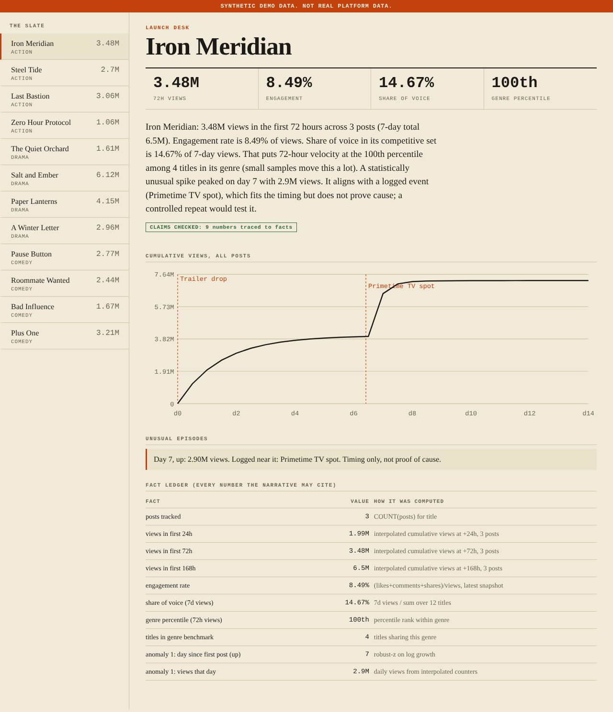
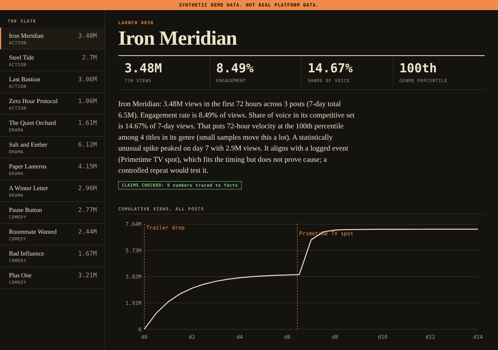
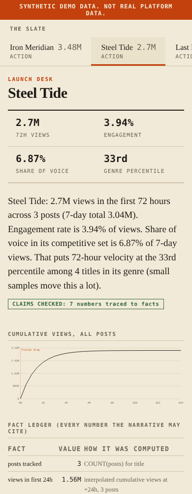
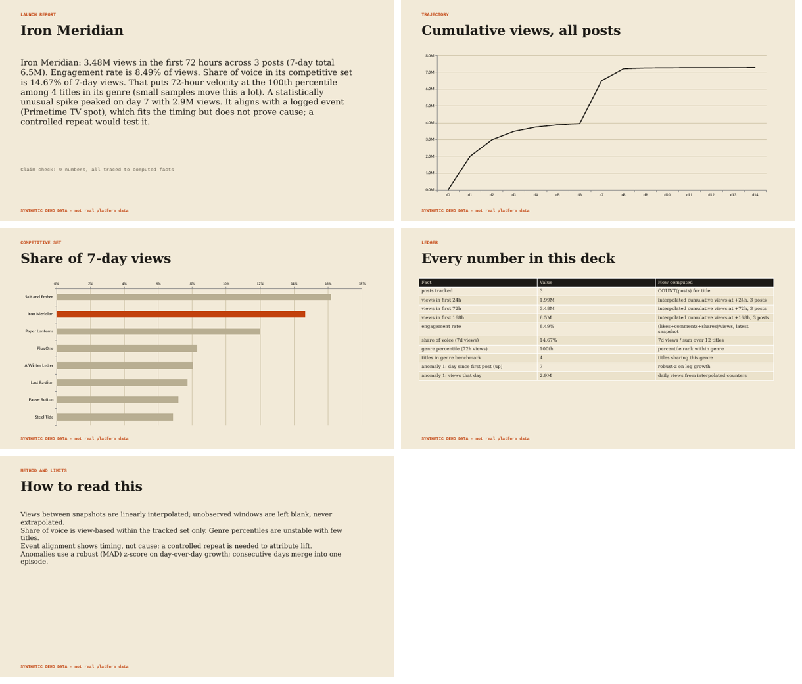
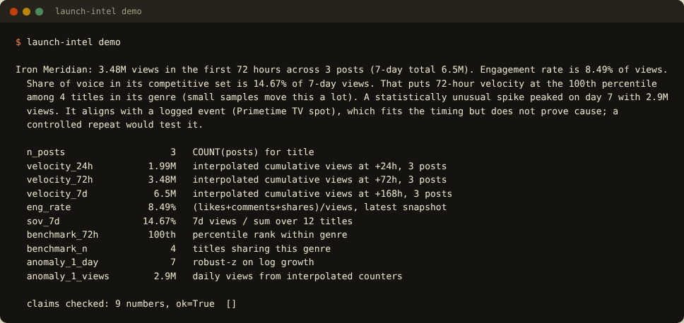

# Launch Intelligence

Answers what a studio social team asks in the first week of a trailer launch: **how fast is it moving, how does it compare, did something unusual happen, and what was running at the time?** Every number in the written summary is traced to a computed fact and claim-checked.

## Screenshots

> **About the screenshots.** All data shown is **synthetic** (the UI says so in an orange banner). Browser images are real captures of this project's own dashboard in Chromium; terminal images are the real stdout of each command, rendered into a terminal-styled page.

### Launch desk


Headline figures, the claim-checked read, cumulative views with logged events marked, the detected episode, and the fact ledger showing how every number was computed.

### Dark mode


The UI follows the system colour scheme.

### Mobile


Phone layout: the slate becomes a horizontal scroller and the figures stack 2x2.

### Executive deck export


The five slides produced by `deck`, rendered through LibreOffice: narrative, trajectory, competitive set, ledger of every number, method and limits.

### Terminal report


`demo` prints the narrative, the fact ledger, and the claim-check verdict.

## What it does

- **Launch velocity** at 24h / 72h / 7 days from time-series snapshots (linear interpolation anchored at publish time; a window that has not been observed returns nothing, never a guess).
- **Engagement rate**, **share of voice** in a competitive set, and **genre percentile** (needs 3+ titles in the genre; the sample size is stated in the narrative).
- **Anomaly episodes**: robust (MAD) detection on day-over-day growth. A spike and its rebound merge into *one* episode reported at its peak, with any **logged events** within 48h attached. Timing is reported as timing, never as proof of cause.
- **Claim-checked narrative**: a deterministic write-up where every number comes from a fact and is checked to be on the right metric and window.
- **Executive deck** (`.pptx`, 5 slides) that refuses to build if its narrative fails verification.
- **Collection**: YouTube Data API client with quota accounting and retry/backoff, validated CSV import (bad rows rejected *with reasons*), scheduled collector. SQLite for development; Postgres through `DATABASE_URL` (optional driver).

## Quick start

```bash
pip install -e ".[deck]"            # add ,postgres for the Postgres driver
launch-intel serve --demo                  # dashboard on http://127.0.0.1:8000 (synthetic data)
launch-intel demo                          # the same report in the terminal
launch-intel deck --demo --title "Iron Meridian" --out report.pptx
python -m unittest discover -s tests -v
```

## Using real data

```bash
export YOUTUBE_API_KEY=...                         # free; each call costs 1 of 10,000 daily quota units
launch-intel check-youtube                                # live smoke test of your key
cp examples/titles.example.json titles.json        # list titles + YouTube video ids
launch-intel collect --config titles.json --db launch_intel.db
launch-intel schedule --config titles.json --every-hours 6 --db launch_intel.db     # long-running collector
launch-intel ingest-csv export.csv --db launch_intel.db   # Meta/TikTok exports: see examples/snapshots.template.csv
launch-intel import-events events.csv --db launch_intel.db  # the 'why' layer: see examples/events.template.csv
launch-intel serve --db launch_intel.db
```
Snapshots must be taken repeatedly over time (the collector does this); one snapshot gives a point, not a trajectory.

## How it works

| Piece | Rule |
|---|---|
| Velocity | Cumulative views interpolated linearly between snapshots, anchored at (publish, 0); `None` if the window is not yet observed |
| Engagement | (likes + comments + shares) / views from each post's latest snapshot, view-weighted across posts |
| Share of voice | Title's 7-day views / sum over the tracked set (view-based, within the set only) |
| Anomalies | Robust z (MAD, floored at 0.05) of day-over-day log growth >= 3.5; consecutive days merge; events within +/-48h attached |
| Verification | Each numeric claim must equal a fact and sit in a clause about that fact's metric; hype and unhedged causation are flagged; titles and event labels are masked so "Trailer 2" is not a number |

Full definitions: `docs/METRICS.md`.

## Status: what is verified and what is not

The build environment had **no network, no Postgres and no real API keys**. Everything below marked *not run* is code that exists and is unit-tested against local fakes, but has never talked to the real service.

| Area | Status |
|---|---|
| 19 tests: metrics, ingestion over real local sockets (retry, headers, quota), CSV validation, event importer, claim verifier, collector isolation, API hardening, deck, real-browser UI | **Pass** (`python -m unittest discover -s tests -v`) |
| Dashboard (light, dark, mobile) | Rendered and inspected in real Chromium; a browser regression test is included |
| Executive deck | Built and rendered through LibreOffice; slide text checked by test |
- Interpolation assumes smooth growth between snapshots; sparse snapshots blur short spikes.
- Share of voice is view-based within the tracked set only; genre percentiles are unstable with few titles (the narrative says so).
- Event alignment shows timing, not cause; a controlled repeat is needed to attribute lift.
- The dashboard has **no authentication**: keep it on localhost or behind your own auth proxy.
- Respect each platform's API terms; store public post metrics only.

## Known limitations

- **Not run:** the live YouTube API (unit-tested over a local HTTP server that mimics its shape), Postgres (the adapter exists; never connected to a server).

## Project layout

```
src/launch_intel/__init__.py
src/launch_intel/catalog.py
src/launch_intel/cli.py
src/launch_intel/db.py
src/launch_intel/deck.py
src/launch_intel/ingest.py
src/launch_intel/metrics.py
src/launch_intel/narrator.py
src/launch_intel/pipeline.py
src/launch_intel/sample_data.py
src/launch_intel/schema.sql
src/launch_intel/web.py
tests/__init__.py
tests/test_core.py
tests/test_delivery.py
docs/METRICS.md
examples/events.template.csv
examples/snapshots.template.csv
examples/titles.example.json
```

See `docs/PORTFOLIO.md` for resume bullets you can defend and the numbers you still need to measure yourself.
